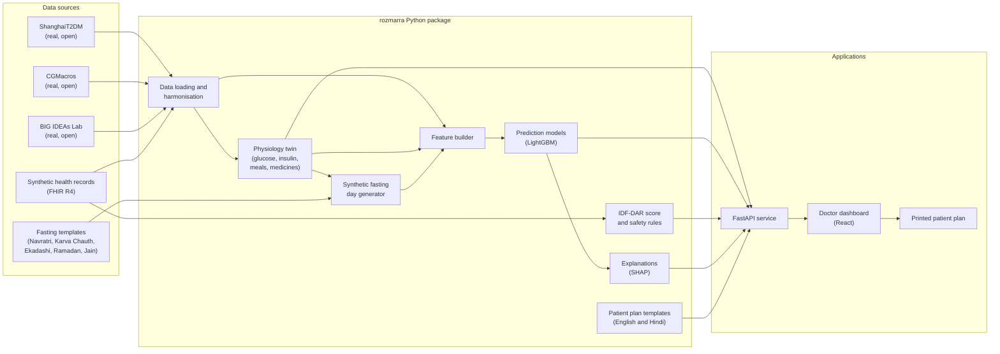

# Rozmarra

Rozmarra is a digital twin that helps doctors keep people with Type 2 Diabetes safe during religious fasts in India.

**Full title:** Rozmarra: A Digital Twin That Predicts Low and High Blood Sugar During Religious Fasting for People with Type 2 Diabetes in India

Rozmarra (रोज़मर्रा) is a Hindi and Urdu word that means "everyday". The name reflects the aim of the project: safe fasting should be a normal, everyday part of diabetes care for people of every faith.

> **Safety notice.** Rozmarra is a research prototype for the Digital Twin Challenge 2026. It is not a certified medical device, and it must not be used to make decisions about real patients. Rozmarra supports clinical decisions. It does not replace the judgement of a doctor.

> **Project status.** The team is building Rozmarra between 12 and 20 October 2026. This README describes the planned system. The team will update each section as the work is completed, and it will not report any result before that result exists.

## 1. Team

| Item | Details |
|---|---|
| Team name | NOT_SOMEONE_IMPORTANT |
| College or incubator | The team will add this information. |
| Members and roles | The team will add this information. |
| Challenge | Digital Twin Challenge 2026 by Happiest Health, part of the Reimagining and Reforming Healthcare in India Summit 2026 |

## 2. Demonstration video

The team will add the link to the demonstration video here. The video will last at least 20 minutes and will be published on YouTube as an unlisted video.

## 3. Problem statement and healthcare use case

**Chronic condition.** Rozmarra focuses on Type 2 Diabetes, and on one specific situation: religious fasting.

- The ICMR-INDIAB study estimated that 101 million people in India have diabetes and that 136 million people have prediabetes (The Lancet Diabetes & Endocrinology, 2023).
- A 2020 study of 300 adults with Type 2 Diabetes in North India found that 49% had fasted in the previous year. Only 1.35% had discussed their diet with a doctor or dietitian before fasting, and only about 4% had checked their glucose during their last fast.
- The EPIDIAR study of 12,243 people with diabetes in 13 countries found that severe low blood sugar needing hospital care was 7.5 times more common during Ramadan for people with Type 2 Diabetes than in other months.

Medicines such as sulfonylureas and insulin can cause low blood sugar when a person does not eat for many hours. Some fasts also do not allow water. The meal that breaks the fast is often large and rich in sugar, and it can cause high blood sugar in the hours that follow.

Doctors can use the IDF-DAR 2021 risk score to place a person into low, moderate or high fasting risk. The score is calculated once, so it cannot show when the risk is highest during the day, how a change in medicine may change the risk, or what is happening during the fast.

**Use case.** Rozmarra aims to help a doctor in three ways:

1. **Before the fast,** the doctor tests a fasting plan on the patient's virtual twin and compares options, such as a lower medicine dose.
2. **During the fast,** Rozmarra aims to predict low blood sugar at least 60 minutes before it happens, and high blood sugar after the fast is broken at least 2 hours before it happens.
3. **After the doctor approves the plan,** Rozmarra prints a clear fasting plan for the patient in English or Hindi.

Rozmarra will support Navratri, Karva Chauth, Ekadashi, Ramadan, Jain fasts and custom fasts. Rozmarra never judges the decision to fast, and it never changes medicines by itself.

## 4. What Rozmarra does

The doctor dashboard will have six screens:

1. Patients who plan to fast
2. Virtual patient
3. Test a fasting plan (the fasting plan simulator)
4. Live fasting monitor
5. Patient fasting plan
6. How Rozmarra makes predictions

The team will add screenshots of each screen here.

## 5. Architecture



The team will add the architecture diagram as a PDF in `docs/architecture/`.

## 6. Technical stack and AI/ML model

| Layer | Tools |
|---|---|
| Data, models and API | Python 3.12, pandas, NumPy, SciPy, PyArrow, LightGBM, scikit-learn, SHAP, FastAPI and Typer |
| Health records | FHIR R4 JSON |
| Patient plans | Jinja2 templates in English and Hindi |
| Dashboard | React, TypeScript, Vite, Tailwind CSS, shadcn/ui, Apache ECharts, TanStack Query and i18next |
| Tests and checks | pytest, Ruff, Vitest and GitHub Actions |

Rozmarra will use three layers that work together:

1. **Physiology twin.** A personalised glucose and insulin model extends the Bergman minimal model with a two-compartment meal model and the effects of medicines that are common in India. These medicines include sulfonylureas, metformin, DPP-4 inhibitors, SGLT2 inhibitors, basal insulin and premixed insulin. The twin uses the CYP2C9 genotype to adjust how quickly the body clears sulfonylureas. The twin answers "what if" questions about a fasting plan.
2. **Prediction model.** LightGBM classifiers will combine the twin's forecasts with CGM, wearable, health record and fasting information to estimate the chance of each adverse event. SHAP values will turn the largest contributions into plain-language reasons.
3. **Clinical score and safety rules.** The IDF-DAR 2021 risk score and simple rules, such as a dehydration caution for long fasts without water, anchor Rozmarra in clinical practice.

The full design is in [`docs/techstack.md`](docs/techstack.md), and the requirements are in [`docs/prd.md`](docs/prd.md).

## 7. Data sources and licences

Rozmarra uses only open anonymised data and synthetic data. The repository does not contain any raw dataset. The download command fetches each dataset from its original source and checks every file against the publisher's checksum.

| Dataset | How Rozmarra uses it | Licence |
|---|---|---|
| ShanghaiT2DM (Scientific Data, 2023) | Fitting the twin's responses to meals and medicines, and testing predictions on real patients | The article uses CC BY 4.0. |
| CGMacros, version 1.0.0 (PhysioNet, 2025) | Fitting responses to meals and activity, and testing the fusion of CGM and smartwatch data | CC BY-NC-SA 4.0 |
| BIG IDEAs Lab Glycemic Variability and Wearable Device Data, version 1.1.3 (PhysioNet) | Calculating heart rate variability from inter-beat intervals | Open Data Commons Attribution License v1.0 |
| Synthetic health records and synthetic fasting days | The static data stream and the fasting days for all virtual patients | Apache License 2.0, released with the code |

Every synthetic record, chart and table in Rozmarra is labelled as synthetic.

## 8. How to run Rozmarra

### 8.1 Requirements

- Python 3.12, managed by [uv](https://docs.astral.sh/uv/)
- Node.js 22 or newer
- Git

On Windows, you can install the tools with these commands:

```powershell
winget install astral-sh.uv
winget install OpenJS.NodeJS.LTS
winget install Git.Git
```

uv installs Python 3.12 for the project automatically.

### 8.2 Setup and demo

On Windows, please run these commands in PowerShell from the repository folder:

```powershell
powershell -ExecutionPolicy Bypass -File scripts\setup.ps1
powershell -ExecutionPolicy Bypass -File scripts\run_demo.ps1
```

On macOS and Linux, please run these commands from the repository folder:

```bash
bash scripts/setup.sh
bash scripts/run_demo.sh
```

The dashboard then opens at http://localhost:5173, and the API documentation is at http://127.0.0.1:8000/docs.

### 8.3 Command-line tool

```powershell
cd backend
uv run rozmarra --help
uv run rozmarra data download    # Downloads the open datasets into data/raw (about 1 GB)
uv run rozmarra serve            # Starts the API at http://127.0.0.1:8000
uv run pytest                    # Runs the backend tests
```

## 9. Results

No results exist yet. The team will test Rozmarra in two parts: on real patients from ShanghaiT2DM and CGMacros whose data was not used for training, and on simulated fasting days for virtual patients who were not used for training. The team will report the measured values here, with their confidence intervals and their limits, even if they fall short of the targets.

## 10. Safety, ethics and limitations

- Rozmarra supports the doctor. The doctor makes and approves every treatment decision.
- Every patient plan shows the rule for breaking the fast: the patient should break the fast if blood sugar is below 70 mg/dL or above 300 mg/dL, or if they feel unwell.
- Patient plan text comes only from fixed templates. Rozmarra does not use AI to write medical advice.
- No doctor or pharmacist has reviewed the clinical content of this prototype. The thresholds, plan templates and medicine assumptions are based on the cited guidelines and studies.
- The real data comes from China and the United States, not from India. The simulated fasting data reflects the team's modelling assumptions.
- The IDF-DAR score was designed for Ramadan. Rozmarra applies it to other fasts as an approximation.
- A real product would need clinical studies with Indian patients and approval as a medical device, for example from the Central Drugs Standard Control Organisation (CDSCO).

## 11. Licence

The Rozmarra code is released under the [Apache License 2.0](LICENSE).

The open datasets keep their own licences. CGMacros uses the CC BY-NC-SA 4.0 licence, so any file derived from it, including trained models, is for non-commercial research use and follows the share-alike terms.

## 12. Presentation

The team will add the presentation as a PDF in `docs/presentation/`.

## 13. References and acknowledgements

1. Anjana RM, et al. Metabolic non-communicable disease health report of India: the ICMR-INDIAB national cross-sectional study (ICMR-INDIAB-17). The Lancet Diabetes & Endocrinology, 2023.
2. Gupta L, et al. Dietary practices during common religious fasts in people with type 2 diabetes mellitus among different religions in North India: a questionnaire-based study. US Endocrinology, 2020;16(1):36–40.
3. Salti I, et al. A population-based study of diabetes and its characteristics during the fasting month of Ramadan in 13 countries: results of the EPIDIAR study. Diabetes Care, 2004.
4. Hassanein M, et al. Diabetes and Ramadan: Practical Guidelines 2021. International Diabetes Federation and DAR International Alliance.
5. Zhao Q, et al. Chinese diabetes datasets for data-driven machine learning (ShanghaiT1DM and ShanghaiT2DM). Scientific Data, 2023;10:35. https://doi.org/10.6084/m9.figshare.c.6310860
6. CGMacros: a scientific dataset for personalized nutrition and diet monitoring. PhysioNet, version 1.0.0, 2025. https://physionet.org/content/cgmacros/
7. BIG IDEAs Lab Glycemic Variability and Wearable Device Data. PhysioNet, version 1.1.3. https://physionet.org/content/big-ideas-glycemic-wearable/
8. Goldberger A, et al. PhysioBank, PhysioToolkit, and PhysioNet: components of a new research resource for complex physiologic signals. Circulation, 2000.
9. Bergman RN, et al. Quantitative estimation of insulin sensitivity. American Journal of Physiology, 1979.
10. Dalla Man C, Rizza RA, Cobelli C. Meal simulation model of the glucose-insulin system. IEEE Transactions on Biomedical Engineering, 2007.
11. Roquemen-Echeverri V, Mosquera-Lopez C. T2DSim AI: Hybrid Neural Digital-Twin Framework for Type 2 Diabetes. https://github.com/mosqueralopez/T2DSim_AI
12. Giammarino F, et al. A machine learning model for week-ahead hypoglycemia prediction from continuous glucose monitoring data. Journal of Diabetes Science and Technology, 2024. https://github.com/flaviagiammarino/stanford-hypoglycemia-forecasting

Rozmarra uses several simple ideas from the T2DSim AI project and the Stanford hypoglycemia forecasting project, which [`docs/techstack.md`](docs/techstack.md) describes. The team wrote its own code for every idea, and this repository contains no code or trained models from either project. The team thanks the authors of these projects and the creators of the open datasets.

The full list of references is in [`docs/prd.md`](docs/prd.md), Section 24.
