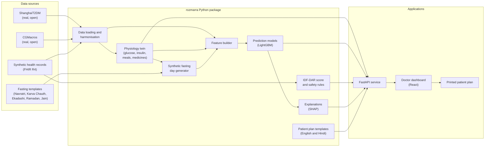

# Rozmarra: Technical Stack and Design

This document describes the tools, data formats, models and code structure that the team will use to build Rozmarra. `prd.md` describes what Rozmarra must do and why.

| Item | Details |
|---|---|
| Document version | 1.0, written on 12 October 2026 |
| Main development computer | A Windows computer |
| Submission deadline | 20 October 2026, 7:00 PM IST |

---

## 1. Guiding principles

1. The team will use only free and open-source tools.
2. Rozmarra will run on an ordinary laptop with Windows 10 or 11, macOS or Linux. The demo will not need a graphics card or an internet connection.
3. All data processing, modelling and prediction logic will live in one Python package called `rozmarra`. The dashboard will only display results from the API. If time runs short, the team can therefore replace the dashboard with a simpler Streamlit version without changing the models.
4. One command will set up the project, and one command will start the demo.
5. Results will be reproducible. The code will use fixed random seeds, and lock files will pin the package versions.
6. All text that people read will follow the writing standard in `prd.md`, Section 17.

## 2. Stack at a glance

| Layer | Choice | Reason |
|---|---|---|
| Language for data, models and the API | Python 3.12 | Python has mature libraries for scientific computing and machine learning. |
| Python environment and packages | uv, with `pyproject.toml` and `uv.lock`. Pip with a virtual environment is the fallback. | uv is fast, and it creates the same environment on every computer. |
| Data handling | pandas, NumPy and PyArrow (Parquet files) | These are standard tools, and Parquet files are small and fast to read. |
| Physiology twin | NumPy for a vectorised Runge–Kutta solver. SciPy for checks (`solve_ivp`) and for fitting (`least_squares`). | The model is small. NumPy can run many simulations at once, which makes the uncertainty bands fast. |
| State updates during a fast | A trend-matched start, which is a simple formula (Must). FilterPy, with an unscented Kalman filter (Should). | Both methods keep the twin in step with new CGM readings. The formula is quick to build, and the filter can replace it later. |
| Prediction models | LightGBM and scikit-learn | LightGBM is accurate on tabular features, handles missing values and trains quickly on a laptop. |
| Explanations | SHAP | SHAP shows how much each input contributed to each prediction. |
| Health record format | FHIR R4 JSON, validated with `fhir.resources` (Should) | FHIR is the international standard for health records. India's Ayushman Bharat Digital Mission (ABDM) also uses FHIR R4. |
| Synthetic medical history | The team's own Python generator (Must). Synthea with Java 17 or 25 (Should). | The Python generator is quick to build and easy to control. Synthea adds a realistic medical history if time allows. |
| API | FastAPI, Uvicorn and Pydantic v2 | FastAPI is quick to build with, and it creates API documentation automatically. |
| Command-line tool | Typer | Typer makes simple commands such as `rozmarra twin fit`. |
| Patient plan text | Jinja2 templates in English and Hindi | Every sentence comes from a fixed, reviewed template. Rozmarra does not use AI to write medical advice. |
| Dashboard | React with TypeScript, built with Vite | The team gets a custom, professional dashboard that it controls fully. |
| Dashboard styling and components | Tailwind CSS and shadcn/ui (built on Radix UI) | These components are accessible and look consistent. |
| Charts | Apache ECharts, through `echarts-for-react` | ECharts draws thousands of points, shaded bands and markers smoothly. |
| Data loading and page routing | TanStack Query and React Router | These libraries load data reliably and move between pages simply. |
| Interface languages | i18next with `react-i18next` | English and Hindi text live in separate files. |
| Fonts | Noto Sans and Noto Sans Devanagari, installed with Fontsource | Both fonts display Latin and Devanagari text clearly, and they work offline. |
| Icons | Lucide | The icons are simple and consistent. |
| Tests and code quality | pytest, Ruff, Vitest and pre-commit. GitHub Actions runs the checks. | These tools catch errors early. |
| Figures for reports | Matplotlib | Matplotlib creates static figures for the presentation and the model card. |
| Architecture diagram | Mermaid in the README. diagrams.net (draw.io) for the PDF version. | GitHub displays Mermaid diagrams, and draw.io produces a polished PDF. |
| Video | OBS Studio, or the screen recording in PowerPoint. YouTube, as an unlisted video. | These tools are free and reliable. |
| Licence | Apache License 2.0 | It is a permissive open-source licence with an explicit patent grant. Synthea uses the same licence. |
| Fallback dashboard | Streamlit | The team will use it only if dashboard screens 1 to 3 do not work by the evening of 17 October. |

## 3. System architecture



The data flows through Rozmarra in the following order:

1. The loaders read the open datasets and the synthetic health records. They convert everything into one standard format (Section 4).
2. The twin is fitted to each real patient's normal days (Section 5).
3. The generator creates virtual patients and simulated fasting days from the fitted twins and the fasting templates (Section 6).
4. The feature builder combines the twin's forecasts with CGM, wearable, health record and fasting information (Section 7).
5. The prediction models estimate the chance of each adverse event, and SHAP explains each estimate.
6. The API serves the results, the IDF-DAR score, the simulations and the patient plans to the dashboard (Section 10).

## 4. Data formats and standards

### 4.1 Standard time-series table

All glucose and wearable data is stored in one long table in Parquet format.

| Column | Type | Description |
|---|---|---|
| `patient_id` | text | The patient identifier, for example "SH-2010-0" for ShanghaiT2DM, "CG-001" for CGMacros or "SY-0001" for a synthetic patient. |
| `timestamp_local` | date and time | The local clock time of the reading. The open datasets shift their dates for privacy, so Rozmarra uses the time of day and the day number, not the calendar date. |
| `timezone` | text | The original time zone. Synthetic Indian patients use Asia/Kolkata (Indian Standard Time). |
| `signal` | text | The type of reading, for example `glucose_cgm`, `heart_rate`, `rr_interval`, `steps`, `mets`, `sleep_stage` or `skin_temperature`. |
| `value` | number | The reading. |
| `unit` | text | The unit, for example mg/dL, beats per minute, ms, steps, MET or °C. |
| `source` | text | Either `real_open` or `synthetic`. |
| `dataset` | text | The dataset name, for example "ShanghaiT2DM", "CGMacros" or "Rozmarra synthetic". |
| `device` | text | The device, for example "FreeStyle Libre H", "Dexcom G6", "Fitbit Sense" or "simulated". |

A second table stores events: meals, medicines, insulin doses, activities and fasting windows. Its columns are `patient_id`, `start`, `end`, `event_type` and `details`. The `details` column holds JSON, for example the carbohydrates in grams, the food category, the medicine name and the dose.

### 4.2 Health records (FHIR R4)

Each synthetic patient has one FHIR R4 Bundle in JSON format with the following resources.

| Resource | Content |
|---|---|
| Patient | This resource holds a synthetic name, sex, birth date, city and preferred language. An extension stores the patient's own word for the fast. |
| Condition | This resource records Type 2 Diabetes (SNOMED CT 44054006) with the date of diagnosis. Other conditions may include hypertension, chronic kidney disease and coronary artery disease. |
| Observation (laboratory) | These resources hold HbA1c (LOINC 4548-4), fasting plasma glucose, fasting insulin, creatinine, eGFR and lipids. |
| Observation (vital signs) | These resources hold weight, height, BMI, blood pressure and resting heart rate. |
| Observation (genetic result) | This resource holds the CYP2C9 genotype, for example \*1/\*3. It follows the HL7 FHIR Genomics Reporting guidance in a simplified form. |
| MedicationStatement | Each resource records one diabetes medicine with its dose and timing, for example "glimepiride 2 mg every morning". |
| Observation (history) | These resources hold the inputs for the IDF-DAR score. The inputs are past episodes of low blood sugar, awareness of low blood sugar, self-monitoring habits, physical work, frailty, support at home and previous fasting experience. |

The team will check every SNOMED CT and LOINC code in the official browsers before use. ABDM publishes FHIR R4 profiles through NRCeS. Rozmarra will not implement the full ABDM profiles in this phase, but its use of FHIR R4 keeps that path open.

### 4.3 Fasting plan (JSON)

The API and the dashboard exchange fasting plans in this format. The values below are an example.

```json
{
  "patient_id": "SY-0001",
  "plan_name": "Plan B: lower glimepiride dose with sargi",
  "fast_type": "karva_chauth",
  "date": "2026-10-28",
  "fast_start": "05:00",
  "fast_end": "20:15",
  "water_allowed": false,
  "meals": [
    {"time": "04:30", "label": "Sargi before sunrise", "food_category": "mixed", "carbs_g": 60},
    {"time": "20:20", "label": "Meal that breaks the fast", "food_category": "fast_absorbing", "carbs_g": 110, "breaks_fast": true}
  ],
  "medicines": [
    {"name": "glimepiride", "dose_mg": 1, "time": "04:30", "usual_dose_mg": 2, "usual_time": "08:00"},
    {"name": "metformin", "dose_mg": 500, "time": "20:30", "usual_dose_mg": 500, "usual_time": "08:00"},
    {"name": "dapagliflozin", "dose_mg": 10, "time": "20:30", "usual_dose_mg": 10, "usual_time": "08:00"}
  ],
  "activities": [
    {"start": "17:00", "end": "18:30", "label": "Evening puja and household work", "mets": 2.5}
  ],
  "status": "draft",
  "approved_by": null,
  "approved_on": null
}
```

The code (`backend/src/rozmarra/fasting/plan.py`) makes two changes to this example. First, every time is a full date and time, so that fasts that last more than one day are clear. Second, each medicine has a `dose` field, and the unit (mg or units) comes from the medicine catalogue, so that insulin doses fit the same format.

Rozmarra uses three food categories:

- The `fast_absorbing` category covers sweets, sabudana, potatoes, fruit juice and dates.
- The `mixed` category covers ordinary mixed meals.
- The `slow_absorbing` category covers meals that are high in fibre, fat or protein.

### 4.4 Wearable data in a published standard (Should)

The team will export one synthetic day of heart rate, step count and sleep data in Open mHealth (IEEE 1752.1) JSON format. This export shows that Rozmarra can work with a published standard for mobile health data.

## 5. Physiology twin

This section gives the starting design. The team will check the equations and parameter values against the cited papers, and may adjust them after fitting. The design extends the Bergman minimal model (1979) with a two-compartment meal model, in the style of Dalla Man and colleagues (2007), and adds medicine effects. It also uses three simple ideas from the T2DSim AI project: medicine activity curves, a starting state that matches the CGM trend, and fitting with safety weights. Rozmarra uses these ideas in its own code and does not copy any T2DSim AI code.

### 5.1 State variables

| Symbol | Meaning | Unit |
|---|---|---|
| G | Plasma glucose | mg/dL |
| X | Insulin action on glucose | per minute |
| I | Plasma insulin | µU/mL |
| D1, D2 | Glucose from a meal in the gut (two compartments) | mg/kg |
| S1, S2 | Injected insulin under the skin (two compartments) | units (U) |

Medicines taken by mouth are not states in the model. Instead, Rozmarra turns each dose into an activity curve (Section 5.2).

### 5.2 Equations

Time t is in minutes. Glucose changes as follows:

$$
\frac{dG}{dt} = P(t) - \big(S_G + X\big)\,G + \frac{R_a(t)}{V_G} - U_R(G) - e_A\,A(t)\,G + c_{cr}\max\big(G_{cr} - G,\,0\big)
$$

The last term is the counter-regulation response. When glucose falls below G_cr, hormones such as glucagon and adrenaline make the liver release more glucose. This response is weaker in people who are unaware of low blood sugar and in people who have had diabetes for a long time.

The term P(t) is the glucose production by the liver:

$$
P(t) = P_0 \cdot f_{fast}(\tau) \cdot \big(1 - e_{met}\,u_{met}(t)\big)
$$

The team will choose P_0 so that glucose is not changing at the patient's fasting level G_b at the time of the morning fasting blood test. This calculation assumes an overnight fast and uses the medicine levels that the usual plan produces at that time of the morning. The term u_met(t) is the activity of metformin, between 0 and 1, from its activity curve.

Insulin action and plasma insulin change as follows:

$$
\frac{dX}{dt} = -p_2\,X + p_2\,S_I\,\big(I - I_b\big)
$$

$$
\frac{dI}{dt} = -n\,\big(I - I_b\big) + \beta\,\big(G - G_b\big)\big(1 + e_{dpp4}\,u_{dpp4}\,\mathbf{1}_{G > G_b}\big) + \gamma_{su}\,E_{su}(t) + \frac{10^6\,k_2\,S_2}{V_I \cdot BW}
$$

In this equation, BW is the body weight in kilograms, and the final term converts absorbed insulin units into a plasma concentration. The solver keeps I at zero or above. The DPP-4 inhibitor term applies only when glucose is above G_b, because these medicines act only when glucose is raised.

When glucose falls below G_b, the β term becomes negative, so the body releases less of its own insulin. This is the body's first defence against low blood sugar. Sulfonylureas keep insulin release high even when glucose is low. This is why they can cause low blood sugar during a fast.

Meals are absorbed through two gut compartments:

$$
\frac{dD_1}{dt} = -k_{abs}\,D_1 + d(t), \qquad \frac{dD_2}{dt} = k_{abs}\,\big(D_1 - D_2\big), \qquad R_a(t) = f\,k_{abs}\,D_2
$$

The term d(t) is the carbohydrate in the meal, in mg per kg of body weight, added at the time of the meal.

Injected insulin moves through two compartments under the skin:

$$
\frac{dS_1}{dt} = u_{ins}(t) - k_1\,S_1, \qquad \frac{dS_2}{dt} = k_1\,S_1 - k_2\,S_2
$$

Medicines taken by mouth follow simple activity curves. This idea comes from the T2DSim AI project. Each dose creates a curve that rises to a peak at the time to peak, t_peak. The curve then falls according to the half-life, h, and it ends at the maximum duration, T_max:

$$
g(t) = \left(\frac{t}{t_{peak}}\right)^{\alpha - 1} e^{-\beta\,(t - t_{peak})} \quad \text{for } 0 \le t \le T_{max}, \qquad \beta = \frac{\ln 2}{h}, \qquad \alpha = 1 + \beta\, t_{peak}
$$

The curve is zero before the dose and after T_max. It reaches exactly 1 at t_peak. Rozmarra adds up the curves of all doses of the same medicine, scaled by the size of each dose:

$$
a(t) = \sum_{j} \frac{\text{dose}_j}{\text{standard dose}} \cdot g\big(t - t_j\big)
$$

In this equation, t_j is the time of dose j. The activity of each medicine enters the model as follows:

- **Sulfonylureas.** The effect on insulin release is E_su(t) = a_su(t) / (EC_50 + a_su(t)).
- **Metformin.** The activity is u_met(t) = min(a_met(t), 1).
- **DPP-4 inhibitors.** The activity is u_dpp4(t) = min(a_dpp4(t), 1).
- **SGLT2 inhibitors.** The urine threshold falls from 180 mg/dL towards 90 mg/dL as the activity rises: θ_R(t) = 180 − 90 × min(a_sglt2(t), 1).

The CYP2C9 genotype makes the sulfonylurea curve last longer. Rozmarra divides the sulfonylurea half-life and maximum duration by the clearance factor c_cyp (Section 5.3).

Glucose loss in the urine depends on kidney function and on SGLT2 inhibitors:

$$
U_R(G) = k_R \cdot \min\!\left(\frac{eGFR}{90},\,1\right) \cdot \max\big(G - \theta_R,\,0\big)
$$

Glucose production falls slowly during a long fast. In the next equation, τ is the time since the last meal, in minutes:

$$
f_{fast}(\tau) = 1 - a_f\left(1 - e^{-\tau/\tau_f}\right)
$$

Physical activity is measured in METs from the smartwatch, or estimated from steps:

$$
A(t) = \min\!\left(\max\!\left(\frac{METs(t) - 1}{5},\,0\right),\,2\right)
$$

### 5.3 Parameters

| Symbol | Meaning | How the team sets it | Starting value or range |
|---|---|---|---|
| G_b | Fasting glucose | From the health record, or from the lowest stable night-time CGM level | Specific to each patient |
| I_b | Fasting insulin | From the health record if available, or else a population value | 10 µU/mL (range 5 to 25) |
| S_G | Glucose effectiveness | Fitted | 0.015 per minute (range 0.005 to 0.035) |
| S_I | Insulin sensitivity | Fitted | 2 × 10⁻⁴ per minute per µU/mL (range 0.3 × 10⁻⁴ to 8 × 10⁻⁴) |
| p_2 | Speed of insulin action | Fixed | 0.02 per minute |
| n | Insulin clearance | Fixed | 0.14 per minute |
| β | Insulin release in response to glucose | Fitted | 0.04 µU/mL per minute per mg/dL (range 0.005 to 0.15) |
| V_G | Glucose distribution volume | Fixed | 1.6 dL/kg |
| V_I | Insulin distribution volume | Fixed | 120 mL/kg |
| f | Share of meal glucose that is absorbed | Fixed | 0.9 |
| k_abs | Meal absorption speed | Set by food category, then multiplied by a fitted personal factor between 0.5 and 2.0 | Fast-absorbing foods: 0.03 per minute. Mixed meals: 0.02 per minute. Slow-absorbing meals: 0.012 per minute. |
| a_f, τ_f | Fall in glucose production during a long fast | Population values. The team will fit them later if fasting data becomes available. | a_f = 0.15 (range 0 to 0.3). τ_f = 720 minutes. |
| e_met | Effect of metformin on glucose production | Population value | 0.2 (range 0.1 to 0.3) |
| e_dpp4 | Effect of a DPP-4 inhibitor on insulin release | Population value | 0.2 (range 0.1 to 0.3) |
| k_R, θ_R | Glucose loss in the urine | Population values | k_R = 0.007 per minute. θ_R is 180 mg/dL without an SGLT2 inhibitor, and falls towards 90 mg/dL as SGLT2 activity rises. |
| γ_su, EC_50 | Sulfonylurea effect on insulin release | Fitted where sulfonylurea data exists, or else population values | γ_su = 8 µU/mL per minute at full effect (range 2 to 15). EC_50 = 0.5. |
| e_A | Effect of activity on glucose uptake | Population value, then fitted on CGMacros | 0.005 per minute per unit of activity |
| c_cr, G_cr | Counter-regulation response to low glucose | Population values. The team multiplies c_cr by 0.3 for people who are unaware of low blood sugar or who have had diabetes for more than 15 years. | c_cr = 0.05 per minute (range 0.01 to 0.1). G_cr = 65 mg/dL. |

The settings for the medicine activity curves are below. They are starting values. The team will check them against product information and pharmacology references.

| Medicine | Time to peak (t_peak) | Half-life (h) | Maximum duration (T_max) | Note |
|---|---|---|---|---|
| Glimepiride | 3 hours | 8 hours | 24 hours | These values match T2DSim AI. |
| Gliclazide MR | 6 hours | 16 hours | 36 hours | The published half-life is 12 to 20 hours. |
| Glibenclamide (glyburide) | 3 hours | 10 hours | 30 hours | Its effects can last up to 24 hours. It has the highest risk of low blood sugar of these three sulfonylureas, and it scores higher in the IDF-DAR score. |
| Metformin | 3 hours | 6 hours | 24 hours | These values match T2DSim AI. |
| SGLT2 inhibitors (dapagliflozin and empagliflozin) | 1.5 hours | 13 hours | 24 hours | These values match T2DSim AI. |
| DPP-4 inhibitors (sitagliptin by default) | 2 hours | 12 hours | 24 hours | The team will check the values for vildagliptin and teneligliptin. |

The CYP2C9 genotype changes the clearance factor c_cyp. Rozmarra uses the CPIC activity score, in which each \*1 allele scores 1, each \*2 allele scores 0.5 and each \*3 allele scores 0. The clearance factor is then c_cyp = 0.3 + 0.35 × activity score. For example, \*1/\*1 gives 1.0, \*1/\*3 gives 0.65 and \*3/\*3 gives 0.3. This mapping is a modelling assumption. Rozmarra divides the sulfonylurea half-life and maximum duration by c_cyp. For a patient with \*1/\*3, the glimepiride half-life therefore becomes about 12 hours instead of 8 hours. The synthetic generator will assign genotypes using South Asian allele frequencies for rs1799853 (\*2) and rs1057910 (\*3) from gnomAD or a published Indian study.

The insulin settings below are also starting values.

| Insulin | How Rozmarra models it | Starting values |
|---|---|---|
| Rapid-acting (aspart, lispro) | Two compartments | k_1 = k_2 = 1/55 per minute |
| Regular human insulin | Two compartments | k_1 = k_2 = 1/120 per minute |
| NPH (intermediate-acting) | Two compartments | k_1 = k_2 = 1/300 per minute |
| Premixed 30/70 | 30% of the dose is modelled as rapid-acting or regular insulin, and 70% as NPH | As above |
| Glargine or degludec (basal) | A constant release over 24 hours | The dose divided by 1,440, in units per minute |

### 5.4 Results of a first check of these starting values

On 12 October 2026, a quick simulation tested the starting values for a 70 kg patient with a fasting glucose of 140 mg/dL. The sulfonylurea tests used the medicine activity curves in Section 5.2. The results are below. They are a sanity check, not a validation.

| Test | Result | What the team should do |
|---|---|---|
| No meals, no medicines and no fasting effect | Glucose stayed at 140 mg/dL for 24 hours. | No action is needed. |
| A 60 g mixed meal | Glucose peaked at about 258 mg/dL after about 80 minutes and returned to the fasting level after about 6 hours. | This result is plausible. The team will compare it with CGMacros meals. |
| A 110 g slow-absorbing meal after a 15-hour fast | Glucose peaked at about 273 mg/dL. | This result is plausible. |
| A 110 g fast-absorbing meal after a 15-hour fast | Glucose peaked at about 400 mg/dL. | This peak is probably too high. The team should fit S_G, β and k_abs to real meals early, and may add a slower absorption factor for meals with a lot of fat. |
| A standard glimepiride dose taken with no food for 15 hours (typical patient) | Glucose fell from 140 mg/dL to a lowest value of about 101 mg/dL after about 5.5 hours. | This fall of about 39 mg/dL is plausible for a standard dose. The team will check it against ShanghaiT2DM patients who take sulfonylureas. |
| The same test for a more sensitive patient (fasting glucose 115 mg/dL, S_I = 4 × 10⁻⁴, CYP2C9 activity score 1.0) | Glucose fell to about 68 mg/dL after about 4.3 hours and was still about 71 mg/dL after 15 hours. With the normal CYP2C9 genotype, it was about 74 mg/dL after 15 hours. With half the dose, the lowest value was about 76 mg/dL. | The model shows the expected effects of a dose reduction and of slower clearance late in the fast. |
| Basal insulin, 18 units a day | Glucose fell by only about 14 mg/dL. | This effect looks weak. The team should fit S_I on ShanghaiT2DM patients who take basal insulin. If the effect stays weak, the team should add a term for the direct effect of insulin on glucose production by the liver. |

### 5.5 Numerical method

- The solver uses a fixed-step fourth-order Runge–Kutta method with a 1-minute step. It is written in NumPy so that it can run many parameter samples at the same time.
- A unit test compares the solver with SciPy `solve_ivp` (LSODA method). The two results must differ by less than 1 mg/dL.
- Meals and doses enter the model at the start of the minute in which they occur.

### 5.6 Fitting each twin

- **Data.** The team uses each real patient's normal days. The first 70% of each patient's days are used for fitting, and the last 30% are held back for testing.
- **Method.** The team uses maximum a posteriori estimation with `scipy.optimize.least_squares`. The fit minimises the weighted squared difference between the simulated and measured CGM values. Penalty terms keep each parameter close to its population value (log-normal priors).
- **Safety weights.** The fit gives extra weight to the errors that matter most for safety. This idea comes from T2DSim AI. The fit multiplies an error by 3 when the measured glucose is below 70 mg/dL and the twin's value is higher, because the twin has missed a low. It also multiplies an error by 3 when the measured glucose is above 250 mg/dL and the twin's value is lower, because the twin has missed a high. The weight of 3 is a starting value.
- **Slope matching.** The fit also compares the change between consecutive readings in the simulation with the change in the CGM data. The twin therefore learns the shape of the glucose curve as well as its level. This idea also comes from T2DSim AI. The starting weight for these slope errors is 3.
- **Windows.** The fit works in 12-hour windows, as T2DSim AI does. Each window starts at the measured CGM value, with a starting state that matches the CGM trend (Section 5.7). This approach stops errors from building up over many hours.
- **Fit report.** For each patient, the report gives the RMSE and the mean absolute relative difference (MARD) on the fitted days and on the held-out days. It also includes a plot of the measured and simulated glucose.
- **Uncertainty.** The team estimates the parameter uncertainty from the Jacobian of the fit (a Laplace approximation). Rozmarra draws 100 parameter samples to create the band from the 10th to the 90th percentile.
- **Reference point.** A review on 12 October 2026 of the 40 trained twins in the T2DSim AI repository found that their median validation RMSE was about 29 mg/dL, with a range of 14 to 58 mg/dL. This result gives a realistic reference for Rozmarra's fit report. The same review found that 25 of these twins had validation data with time below 70 mg/dL, and that 7 of those twins predicted no time below 70 mg/dL at all. A twin alone can therefore miss low blood sugar. For this reason, Rozmarra's alert model also uses the CGM readings directly (Section 7).

### 5.7 Starting each forecast and keeping the twin up to date

**Trend-matched start (Must).** This method is a simpler form of an idea from T2DSim AI. At the start of each forecast, Rozmarra sets G to the latest CGM value. It measures the CGM trend s as the slope of a straight line through the readings of the last 30 minutes. It then chooses the insulin action X so that the twin's starting slope equals s:

$$
X_0 = \frac{P(t) + R_a(t)/V_G - U_R(G) - e_A\,A(t)\,G + c_{cr}\max\big(G_{cr} - G,\,0\big) - s}{G} - S_G
$$

Rozmarra keeps X_0 between −0.5 × S_G and 0.05 per minute. It then sets the plasma insulin to I_0 = I_b + X_0 / S_I, which agrees with X_0, and keeps I_0 at zero or above. The other states come from the simulation of the previous hours.

**Kalman filter (Should).** An unscented Kalman filter may later replace the trend-matched start. It would update G, X, I, D1 and D2 with each CGM reading. The starting measurement noise would be about 10 mg/dL.

### 5.8 Virtual patients

- The generator samples each virtual patient's twin parameters from the parameters that were fitted on real patients in the training group only.
- The average-patient curve in the fasting plan simulator uses the median parameters of all fitted twins in the training group. It uses the same plan, the same starting glucose and the same medicines as the patient's own twin.
- Each virtual patient receives a synthetic Indian health record that is consistent with those parameters. For example, lower insulin sensitivity goes with a higher HbA1c.

## 6. Synthetic data generator

### 6.1 Health records

The starting distributions are listed below. The data card will record the source for each choice.

- **Age and sex.** Ages range from 35 to 80, and both sexes are represented.
- **Body size.** The generator interprets BMI with the cut-offs for Asian populations.
- **Diabetes.** The time since diagnosis ranges from 1 to 25 years, and HbA1c ranges from 6.5% to 11%.
- **Kidney function.** The eGFR ranges from 30 to 110 mL/min/1.73 m².
- **Medicines.** The medicine combinations reflect common practice in India. They include metformin; sulfonylureas (glimepiride, gliclazide and some glibenclamide); DPP-4 inhibitors (sitagliptin, vildagliptin and teneligliptin); SGLT2 inhibitors (dapagliflozin and empagliflozin); basal insulin; and premixed insulin. The team will base the proportions on published Indian prescribing studies.
- **Genetics.** The generator assigns CYP2C9 genotypes using South Asian allele frequencies.
- **Fasting habits.** Each record states which fasts the patient keeps and the patient's own word for the fast.
- **IDF-DAR inputs.** Each record includes past episodes of low blood sugar, awareness of low blood sugar, self-monitoring habits, physical work, frailty, support at home, heart disease and previous fasting experience.
- **Names and cities.** The generator chooses synthetic Indian names and cities from fixed lists.

### 6.2 Fasting days

For each virtual patient and each type of fast, the generator creates the following parts:

- **Schedule.** The generator sets the start and end of the fast. Where possible, it uses real sunrise, sunset and moonrise times for the patient's city.
- **Meals.** The generator sets the time, food category and carbohydrates of each meal. Examples include vrat foods during Navratri, sargi and the meal that breaks the fast on Karva Chauth, and suhoor and iftar during Ramadan.
- **Water.** The generator records whether water is allowed during the fast.
- **Medicines.** The generator uses either the usual plan or a changed plan. It includes some dose reductions so that the data shows how dose changes affect risk.
- **Activity.** The generator adds activities such as garba or dandiya in the evening during Navratri, night prayers during Ramadan, household work and paid work.
- **Sleep.** The generator splits sleep during Ramadan because of suhoor, and it starts sleep later during Navratri.
- **History.** The generator creates 7 to 14 normal days before each fast, so that Rozmarra can use the patient's recent CGM history.

The starting size is 300 virtual patients, with several fasting days for each type of fast. The team will increase the size if the number of events is too small for reliable testing.

### 6.3 Wearable signal models

These models are assumptions based on published physiology. Results on simulated data therefore partly reflect these assumptions. The real-data tests in Section 8 check whether wearable signals help in real life.

| Signal | How the generator creates it |
|---|---|
| CGM glucose | The generator takes the glucose from the twin and delays it by 5 to 10 minutes. It adds correlated sensor noise with a standard deviation of about 6 to 10 mg/dL and some missing readings. It limits values to between 40 and 400 mg/dL and samples every 5 minutes. |
| Heart rate | The heart rate is the resting heart rate plus five parts: a daily rhythm; an activity effect of about 8 to 10 beats per minute for each MET above rest; a rise when glucose is low, up to about 15 to 20 beats per minute below 60 mg/dL; a small rise during long fasts without water; and random noise. The rise during low glucose is smaller in older people, in people who have had diabetes for a long time, in people who are unaware of low blood sugar, and in people who take beta-blockers. |
| Heart rate variability (RMSSD) | Heart rate variability falls when the heart rate rises because of stress or low glucose. The generator also adds random noise. |
| Steps and METs | The generator follows a daily activity pattern for each occupation and type of fast. It includes garba or dandiya sessions and night prayers. |
| Sleep stages | The generator creates sleep periods with awake, light, deep and REM stages. Sleep is split during Ramadan because of suhoor, and it starts later during Navratri. |
| Skin temperature (Could) | The generator follows a daily rhythm and adds the effect of activity. |

### 6.4 Event labels

- Rozmarra finds events in the CGM signal using the definitions in `prd.md`, Section 10.
- A low blood sugar event starts when glucose stays below 70 mg/dL for at least 15 minutes. With 5-minute data, this means three readings in a row. With 15-minute data, it means two readings in a row. The event ends when glucose stays at or above 70 mg/dL for at least 15 minutes.
- For E1, each time point t during a fasting window (every 5 minutes) receives the label 1 if an E1 event starts within the next 60 minutes. Time points where glucose is already below 70 mg/dL are not used for training.
- For E2, each meal that breaks the fast receives the label 1 if an E2 event occurs within the 4 hours after the meal. Rozmarra makes the E2 prediction 2 hours before the meal.
- **Data completeness.** Rozmarra uses a time point for training or testing only when at least 70% of the expected CGM readings are present in the last 2 hours and in the period that the label covers. This rule follows the Stanford hypoglycemia forecasting project, which uses the same 70% level for whole weeks. The dashboard applies the same rule before it shows a prediction.

## 7. Prediction models

### 7.1 Features

| Group | Features |
|---|---|
| CGM | This group includes the current value; the change over 15, 30 and 60 minutes; the slope over 30 minutes; the lowest value and the standard deviation over 2 hours; the time below 70 mg/dL in the last 24 hours; and the number of missing readings. |
| Recent CGM history | This group includes the time below 70 mg/dL, the glucose variability (coefficient of variation) and the number of low blood sugar events over the past 7 days, and over the past 14 days when that much data exists. It also includes the number of days of history. The Stanford project uses one week of CGM history to predict low blood sugar in the following week. |
| Twin | This group includes the forecasts at 30, 60 and 120 minutes; the 10th percentile of the 60-minute forecast; the predicted lowest value in the next 2 hours and its time; the insulin still active in the body; the sulfonylurea effect level; the carbohydrates still being absorbed; and the fasting factor for glucose production. |
| Wearables | This group includes the current heart rate and its difference from the patient's usual heart rate at that time of day; the heart rate slope over 30 minutes; the current RMSSD compared with the patient's usual value; the steps in the last 30 and 60 minutes; the current METs; and the hours of sleep last night. |
| Fasting context | This group includes the type of fast; the minutes since the fast started; the minutes until the fast ends; whether water is allowed; the minutes since the last meal; and the carbohydrates in the last meal. For E2, it also includes the planned carbohydrates and food category of the meal that breaks the fast. |
| Health record | This group includes age, sex, BMI, years with diabetes, HbA1c and eGFR; the medicine classes and doses; the CYP2C9 activity score; past severe low blood sugar; unawareness of low blood sugar; beta-blocker use; heart disease; and the IDF-DAR total score. |

### 7.2 Models

- Rozmarra uses one LightGBM binary classifier for each target. The Must targets are E1 at 60 minutes and E2 at 2 hours before the meal that breaks the fast. The Should targets are E1 at 120 minutes and E3 at 60 minutes.
- The team will start with simple settings, for example 300 trees, a learning rate of 0.05 and 31 leaves. The team will tune the settings with Optuna only if time allows.
- The team will calibrate the probabilities with isotonic regression on a separate validation set.
- The team will choose the alert threshold on the validation set so that 80% of events are detected. The team will then report the false alerts per patient per day on the test set.
- The team will also report results at a second threshold, where sensitivity equals specificity. The Stanford project uses this method.
- The starting risk words are as follows: an estimated chance below 20% is Low, 20% to 50% is Moderate, and above 50% is High. A clinical expert should review these thresholds.
- Rozmarra does not repeat the same alert within 30 minutes unless the risk rises further.
- (Could) The team may train a small PyTorch LSTM model as a comparison.

### 7.3 Plain-language explanations

Rozmarra uses the SHAP TreeExplainer to find the three features that raised the risk the most. It turns each feature into a sentence from a template in the English and Hindi text files. The table shows some examples.

| Feature | English sentence template |
|---|---|
| `minutes_since_last_meal` | "No food has been eaten for {hours} hours." |
| `su_effect_level` | "{medicine} was taken at {time}, and its effect is near its peak." |
| `hr_delta_from_usual` | "The heart rate has risen by {value} beats per minute without extra activity." |
| `cgm_change_30min` | "Glucose has fallen by {value} mg/dL in the last 30 minutes." |
| `twin_lowest_120min` | "The twin predicts a lowest value of {value} mg/dL at about {time}." |
| `steps_last_60min` | "The patient has walked {value} steps in the last hour." |

## 8. Evaluation

- **Splits.** The team uses five-fold cross-validation grouped by patient (GroupKFold) for real data. The team creates virtual test patients only from real patients in the test fold.
- **Twin forecasts.** The team tests the twin on each patient's held-out days.
- **Event metrics.** The team reports AUROC, AUPRC, sensitivity, specificity, balanced accuracy, false alerts per patient per day, the median warning time, the Brier score and a calibration curve.
- **Glucose levels.** The team reports E1 results at 70 mg/dL and also at 54 mg/dL, the level for clinically significant low blood sugar. The Stanford project uses the 54 mg/dL level.
- **Data completeness.** The team scores only the time points that meet the 70% rule in Section 6.4.
- **Forecast metrics.** The team reports RMSE, mean absolute error and the Parkes error grid for Type 2 Diabetes.
- **Baselines.** The team compares the models with the last glucose value, a straight-line trend, the IDF-DAR score alone, a model that uses only CGM data, and the twin alone.
- **Ablation.** The team compares models that use the health record alone, wearables alone, CGM alone, CGM with wearables, and all streams together.
- **Confidence intervals.** The team computes 95% intervals with 1,000 bootstrap samples drawn by patient.
- **Subgroups.** The team reports results by medicine type, for age 65 and over, for eGFR below 60, and by sex.
- **Outputs.** The evaluation writes `reports/metrics.json`, figures in `reports/figures/` and the results section of `docs/model_card.md`.

## 9. IDF-DAR 2021 risk score calculator

The calculator follows the IDF-DAR 2021 risk score table.

| Item | Points |
|---|---|
| Type of diabetes | Type 1: 1. Type 2: 0. |
| Years with diabetes | 10 years or more: 1. Fewer than 10 years: 0. |
| Low blood sugar | Unaware of low blood sugar: 6.5. Recent severe episode: 5.5. Several episodes a week: 3.5. Fewer than one a week: 1. None: 0. |
| HbA1c | Above 9%: 2. From 7.5% to 9%: 1. Below 7.5%: 0. |
| Treatment | Mixed insulin several times a day: 3. Basal-bolus insulin or an insulin pump: 2.5. Mixed insulin once a day: 2. Basal insulin: 1.5. Glibenclamide: 1. Gliclazide MR, glimepiride or repaglinide: 0.5. Other treatments: 0. |
| Self-monitoring of blood glucose | Needed but not done: 2. Done less than needed: 1. Done as needed: 0. |
| Acute complications (DKA or HHS) | In the last 3 months: 3. In the last 6 months: 2. In the last 12 months: 1. None: 0. |
| Heart and blood vessel disease | Unstable: 6.5. Stable: 2. None: 0. |
| Kidney function (eGFR, mL/min/1.73 m²) | Below 30: 6.5. From 30 to 45: 4. From 45 to 60: 2. Above 60: 0. |
| Pregnancy | Not within targets: 6.5. Within targets: 3.5. Not pregnant: 0. |
| Frailty and cognition | Impaired cognition or frailty: 6.5. Older than 70 without support at home: 3.5. None: 0. |
| Physical work | High intensity: 4. Moderate intensity: 2. None: 0. |
| Previous fasting experience | Overall negative: 1. Neutral or positive: 0. |
| Fasting hours | 16 hours or more: 1. Fewer than 16 hours: 0. |

The total score gives the risk category: 0 to 3 is Low, 3.5 to 6 is Moderate, and more than 6 is High.

The calculator follows these implementation rules:

- If a patient takes more than one treatment, the calculator uses the highest score among them. This is a team assumption, because the guideline tool asks for a single treatment type.
- The calculator does not guess missing information. It shows "Information missing" for each missing item. It then calculates the score from the available items and also shows the range of possible totals.
- The IDF-DAR score was designed for Ramadan. Rozmarra applies it to other fasts as an approximation, and the dashboard says so.

Unit tests will use the demo patients. The expected totals are as follows:

| Demo patient | Items that score points | Expected total and category |
|---|---|---|
| Sunita Sharma | HbA1c 8.4% (1), glimepiride (0.5), self-monitoring done less than needed (1) | 2.5, Low |
| Ramesh Patel | 15 years with diabetes (1), low blood sugar fewer than once a week (1), HbA1c 7.9% (1), mixed insulin twice a day (3), stable heart disease (2), eGFR 52 (2), fasting for 16 hours or more (1) | 11, High |
| Abdul Rahman | 10 years with diabetes (1), low blood sugar fewer than once a week (1), HbA1c 7.6% (1), basal insulin (1.5), self-monitoring done less than needed (1), moderate physical work (2), negative previous Ramadan experience (1) | 8.5, High |
| Kamla Devi | 20 years with diabetes (1), glibenclamide (1), older than 70 without support at home (3.5), eGFR 48 (2) | 7.5, High |

## 10. API

The API runs at `http://127.0.0.1:8000/api`. FastAPI also publishes interactive documentation at `http://127.0.0.1:8000/docs`.

| Method | Path | Purpose |
|---|---|---|
| GET | `/health` | Checks that the service is running. |
| GET | `/patients` | Lists the patients with their fast date, IDF-DAR category, predicted risk and plan status. |
| GET | `/patients/{patient_id}` | Returns the health record summary and the data sources. |
| GET | `/patients/{patient_id}/timeseries?start=&end=` | Returns glucose and wearable data with meals and medicines. |
| GET | `/patients/{patient_id}/idf-dar` | Returns the score, the points for each item and any missing items. |
| GET | `/patients/{patient_id}/twin` | Returns the twin parameters and the fit quality. |
| POST | `/patients/{patient_id}/simulate` | Runs one fasting plan. It returns the glucose curve, the uncertainty band, the average-patient curve, the predicted events, the risks and the reasons. |
| POST | `/patients/{patient_id}/compare` | Runs two fasting plans and returns both results. |
| GET | `/patients/{patient_id}/replay?at=` | Returns the forecast, the risk and the alerts at a chosen time in a recorded fasting day. If there is not enough recent CGM data, it returns a clear message instead of a prediction. |
| POST | `/patients/{patient_id}/plans/{plan_id}/approve` | Records that the named doctor approved the plan. |
| GET | `/patients/{patient_id}/plans/{plan_id}/document?lang=en` | Returns the patient fasting plan as printable HTML. The `lang` value can be `en` or `hi`. |
| GET | `/model-card` | Returns the metrics, data sources and limitations. |

During development, the API allows requests from the dashboard at `http://localhost:5173`. A small SQLite file stores plan approvals for the demo.

## 11. Dashboard

### 11.1 Pages

| Route | Screen in `prd.md`, Section 12 |
|---|---|
| `/patients` | Screen 1: Patients who plan to fast |
| `/patients/:id` | Screen 2: Virtual patient |
| `/patients/:id/simulator` | Screen 3: Test a fasting plan |
| `/patients/:id/monitor` | Screen 4: Live fasting monitor (replay) |
| `/patients/:id/plan` | Screen 5: Patient fasting plan |
| `/about` | Screen 6: How Rozmarra makes predictions |

### 11.2 Main glucose chart

- The horizontal axis shows the time on the 12-hour clock.
- A shaded band shows the target range from 70 to 180 mg/dL, with the label "Target range".
- Labelled lines mark 70 mg/dL and 54 mg/dL.
- A solid line shows the measured CGM values. A dashed line shows the forecast, with a shaded band from the 10th to the 90th percentile.
- In the fasting plan simulator, a grey dotted line shows the average-patient curve, with the label "Average patient with the same plan". This line shows how the patient's own twin differs from an average patient.
- A light background shows the fasting window, with a label such as "Fast without food or water".
- Markers show meals with their carbohydrates, medicines with their doses, and alerts.
- Panels below the chart show heart rate, heart rate variability and steps on the same time axis.
- Low glucose is shown with a colour, an icon and the word "Low", so that the chart does not rely on colour alone. The colours are colour-blind-safe.

### 11.3 Text and translation

- All interface text lives in `src/i18n/en.json` and `src/i18n/hi.json`. The components do not contain hard-coded text.
- A native Hindi speaker reviews the Hindi text.
- The command `rozmarra check-language` checks the English text against the list of words to avoid in `prd.md`, Section 17.3.

### 11.4 Accessibility

- The dashboard meets WCAG 2.1 AA. Text has a contrast ratio of at least 4.5 to 1.
- Every control works with the keyboard and shows a visible focus outline.
- Every chart has a short text summary for screen readers.
- The minimum text size is 16 pixels.

### 11.5 Printing the patient plan

- A print stylesheet formats the plan for A4 paper, with text of at least 14 points.
- The plan shows the doctor's name and the approval date.
- The rule for breaking the fast appears in a box near the top of the plan.
- A button labelled "Print or save as PDF" opens the browser's print dialog.

## 12. Repository structure

```text
Rozmarra/                          GitHub repository (the local folder name can differ)
├── README.md
├── LICENSE                        Apache License 2.0
├── .gitignore                     Ignores data/raw/, data/processed/, .venv/, node_modules/, .env and private planning files
├── docs/
│   ├── prd.md
│   ├── techstack.md
│   ├── model_card.md
│   ├── data_card.md
│   ├── architecture/              architecture.drawio and Rozmarra_Architecture.pdf
│   ├── presentation/              Rozmarra_Presentation.pdf (and .pptx)
│   └── images/                    Screenshots for the README
├── backend/
│   ├── pyproject.toml
│   ├── uv.lock
│   ├── src/rozmarra/
│   │   ├── cli.py                 Typer commands
│   │   ├── config.py
│   │   ├── data/                  download.py, shanghai.py, cgmacros.py, harmonise.py
│   │   ├── ehr/                   generator.py, fhir.py, synthea_import.py
│   │   ├── fasting/               templates.py, calendar.py, meals.py
│   │   ├── twin/                  model.py, medicines.py, solver.py, fit.py, kalman.py, simulate.py, virtual_patients.py
│   │   ├── synth/                 wearables.py, cohort.py
│   │   ├── risk/                  idf_dar.py, rules.py
│   │   ├── ml/                    labels.py, features.py, train.py, evaluate.py, explain.py
│   │   ├── plans/                 render.py, templates/en/, templates/hi/
│   │   ├── language/              check.py, words_to_avoid.yaml
│   │   └── api/                   main.py, schemas.py, routes/
│   └── tests/
├── frontend/
│   ├── package.json
│   └── src/                       pages/, components/, charts/, api/, i18n/, styles/
├── data/
│   ├── raw/                       Downloaded datasets (not committed)
│   ├── processed/                 Harmonised Parquet files (not committed)
│   └── demo/                      A small synthetic demo group (committed)
├── models/                        Trained demo models (committed if small)
├── reports/                       Metrics and figures
├── notebooks/                     Exploration and figures
├── scripts/                       setup.ps1, setup.sh, run_demo.ps1, run_demo.sh
└── .github/workflows/ci.yml
```

## 13. Commands

### 13.1 Setup on Windows (PowerShell)

```powershell
# Check the installed tools
python --version   # Python 3.12
node --version     # Node.js 22 or newer
git --version
uv --version

# Install the backend
cd backend
uv sync

# Install the dashboard
cd ..\frontend
npm install
```

On macOS and Linux, the commands are the same except for the path separator.

### 13.2 Pipeline

```powershell
cd backend
uv run rozmarra data download                  # Downloads the open datasets into data/raw
uv run rozmarra data prepare                   # Converts them into the standard format
uv run rozmarra twin fit                       # Fits a twin to each real patient
uv run rozmarra synth cohort --patients 300 --seed 2026
uv run rozmarra model train
uv run rozmarra model evaluate                 # Writes reports/metrics.json and figures
uv run rozmarra demo build                     # Prepares the demo patients and saved results
uv run rozmarra serve                          # Starts the API at http://127.0.0.1:8000
uv run rozmarra check-language                 # Checks text against the words to avoid
```

### 13.3 Dashboard and demo

```powershell
cd frontend
npm run dev        # Opens the dashboard at http://localhost:5173
npm run test
npm run build
```

The script `scripts/run_demo.ps1` (or `scripts/run_demo.sh`) starts the API and the dashboard with the committed demo data. It does not need the large datasets.

### 13.4 Notes on downloading the data

- **ShanghaiT2DM.** The data is in the Figshare collection 6310860. The Figshare API lists the files at `https://api.figshare.com/v2/collections/6310860/articles`. The Excel files have the columns "Date", "CGM", "CBG", "Blood ketone", "Dietary intake", "Insulin dose-s.c.", "Insulin dose-i.v.", "Non-insulin hypoglycemic agents", "CSII-bolus insulin" and "CSII-basal insulin". Some cells may contain Chinese text. A small translation table will map the medicine names, for example 二甲双胍 = metformin, 格列美脲 = glimepiride, 格列齐特 = gliclazide, 格列本脲 = glibenclamide, 阿卡波糖 = acarbose, 西格列汀 = sitagliptin, 达格列净 = dapagliflozin, 甘精胰岛素 = insulin glargine and 门冬胰岛素 = insulin aspart. If the meal text is hard to read, the team will use the meal times with a default meal size, and the twin will fit a personal meal-size factor.
- **CGMacros.** The team will use the download link or the `wget` command on the PhysioNet page. The minute-level files have the columns "Timestamp", "Libre GL", "Dexcom GL", "HR", "Calories (Activity)", "Mets", "Meal Type", "Calories", "Carbs", "Protein", "Fat", "Fiber", "Amount Consumed" and "Image Path". The "Mets" value is multiplied by 10. The dataset does not appear to include medicine records, and the team will check this in the files.
- **Synthea (Should).** The team will build Synthea in a folder without spaces, for example `C:\tools\synthea`. It needs Java 17 or 25. The command `run_synthea -s 2026 -p 1000 --exporter.fhir.export=true` creates FHIR R4 records. The team will then keep only adults with Type 2 Diabetes (SNOMED CT 44054006) and add the India-specific fields.

## 14. Quality checks

The team will write these unit tests:

- **IDF-DAR calculator.** The tests cover the four demo patients in Section 9 and the edge cases at each boundary.
- **Twin steady state.** For a test patient with no meals, no medicines and no fasting effect (a_f = 0), glucose stays within 1 mg/dL of G_b for 24 hours.
- **Twin meal response.** A meal with 50 g of carbohydrate raises glucose by a plausible amount for typical Type 2 Diabetes parameters.
- **Solver.** The NumPy solver matches SciPy `solve_ivp` to within 1 mg/dL.
- **Medicine activity curves.** For a standard dose, each curve reaches exactly 1 at its time to peak. It is zero before the dose and after the maximum duration.
- **Trend-matched start.** When the measured CGM trend is s, the first simulated minute changes glucose at a rate within 0.1 mg/dL per minute of s, unless the limits on X_0 apply.
- **Event labels.** The 15-minute rule works for both 5-minute and 15-minute data.
- **Fasting templates.** Each template follows its rules. For example, the Karva Chauth template allows no water between sunrise and moonrise.
- **API.** Each endpoint returns data in the documented shape.
- **Patient plans.** Both the English and the Hindi templates render without missing values.

The team will also use these tools:

- Ruff checks and formats the Python code.
- Vitest tests the dashboard components.
- GitHub Actions runs the Python tests, the dashboard tests and the dashboard build on every push.
- `rozmarra check-language` fails if any English text uses a word from the list of words to avoid. The check skips the list of words to avoid itself, the "Not:" examples in the writing standard, the original titles of references, the names of other projects and the column names of the datasets, because these must keep their original wording.

## 15. Licences

| Item | Licence | What the team will do |
|---|---|---|
| Rozmarra code | Apache License 2.0 | The team adds a LICENSE file and a licence section to the README. |
| ShanghaiT2DM | The article uses CC BY 4.0. The data files do not state a separate licence. | The team cites the dataset, does not redistribute it, and downloads it with a script. |
| CGMacros | CC BY-NC-SA 4.0 | The team cites the dataset and does not redistribute the raw files. Files derived from it, including trained models, are for non-commercial research use and follow the share-alike terms. |
| Synthea | Apache License 2.0 | The team cites the tool. |
| T2DSim AI (ideas only) | A research licence from Oregon Health & Science University (OHSU). It does not allow anyone to redistribute the code. | The team uses ideas only and writes its own code. The team does not copy any code or trained twins, does not install the `t2dsim-ai` package, and cites the project. |
| Stanford hypoglycemia forecasting (ideas only) | GNU General Public License v3.0 (GPL-3.0) | The team uses ideas only and writes its own code. Copying the code would force the whole project to use GPL-3.0. The team cites the project. |
| Noto fonts | SIL Open Font License 1.1 | The fonts are included through Fontsource. |
| Other libraries | Their own open-source licences | The package managers list these licences. |

## 16. Optional extras

| Extra | Priority | Notes |
|---|---|---|
| Docker Compose setup | Could | This setup starts the API and the dashboard with one command on any computer that has Docker. |
| Hosted demo | Could | One option is a static version of the dashboard with saved results on GitHub Pages, Netlify or Vercel. Another option is the full application on Hugging Face Spaces (Docker) or Render. |
| AI-READI data | Could | The team would need an approved data access request. The submission does not depend on it. |
| LSTM comparison | Could | A small PyTorch model would show how a deep learning model compares with LightGBM. |
| Open mHealth export | Should | See Section 4.4. |

## 17. Known technical risks

| Risk | What the team will do |
|---|---|
| The local folder path contains spaces ("Digital Twin Happiest Health"). | The team will quote paths in scripts and build Synthea in a folder without spaces. |
| Windows limits the length of file paths. | The team will keep paths short and run `git config --global core.longpaths true` if needed. |
| The datasets use different CGM intervals (5 and 15 minutes). | Rozmarra resamples to a 5-minute grid and marks gaps. It never fills gaps longer than 30 minutes. |
| The open datasets shift their dates for privacy. | Rozmarra uses the time of day and the day number, not the calendar date. |
| Events are rare. | The team reports AUPRC as well as AUROC, does not oversample the test set, and reports confidence intervals. |
| The data comes from different time zones. | Rozmarra stores the local clock time with the original time zone, and uses Indian Standard Time for synthetic Indian patients. |
